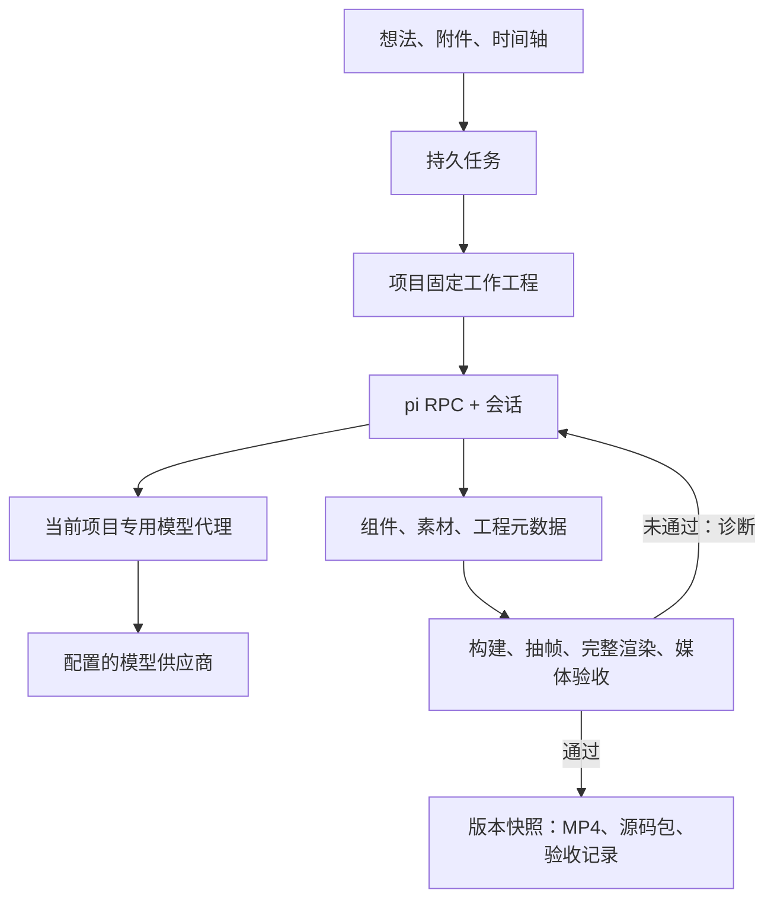

# pi Goal 视频工程

## 职责

- `workbench.js` 提供项目列表、项目对话、原生成片预览、历史版本、素材和交付记录；`pi-history.js` 通过 `project-history.mjs` 的字节游标分页查看和增量更新原生 pi 执行历史。
- `workspace-projects.mjs` 保存项目与对话，将每条消息转换为同一项目 session 的 pi Goal 输入。
- `generation-jobs.mjs` 保存输入、检查点、阶段、轮次和失败原因，负责取消与恢复。
- `video-projects.mjs` 创建独立版本、代理模型访问、调度 Goal 和独立验收。
- `pi-executor.mjs` 在当前任务中运行 RPC 子进程，显式加载项目持久会话，等 `agent_settled` 后进入验收。
- `project-session.mjs` 登记原生会话身份与用户消息编号，确保恢复原 session。
- `agent-sandbox.mjs` 生成宿主控制的 macOS 策略，创建干净环境并管理进程组。
- `agent-render-worker.mjs` 在受限进程中检查类型、构建、渲染帧和完整视频。
- `templates/remotion-v1` 提供固定入口、字幕、布局观测、依赖使用文档和自由创作入口。



## 文件布局

```text
artifacts/projects/<projectId>/workspace/
  GOAL.md / AGENTS.md                 宿主维护的目标与工程规则
  src/Video.tsx + 自由添加的文件       模型开发的视频源码
  src/Root.tsx / src/index.ts         宿主入口、规格、字幕、文字检查
  public/                             独立素材
  project.json                        创作规格与片段说明
  assets.json / storyboard.json       输入素材索引与可选解说时间轴
  package.json / package-lock.json    固定依赖
  node_modules -> 宿主只读依赖
  docs/capabilities.md                 能力与 API 查阅入口
  .video-flow/spec.json                宿主计算的实际渲染规格
  .video-flow/tools.mjs                构建、抽帧、短预览桥接命令
  control/session.jsonl               项目唯一的原生 pi 会话
  control/pi/models.json              当前任务临时代理配置
  home/ / tmp/                        独立用户目录与临时目录
  REVIEW.md                           模型创作与自审说明
  output/                             构建包、帧、视频、验收、源码包
  .video-flow/session.json             宿主登记的原生 session ID
artifacts/projects/<projectId>/<jobId>/ 发布版本快照，含 revision.json
artifacts/sandbox-policies/<projectId>/ 工程外的执行策略
artifacts/jobs/<jobId>.json            任务输入与检查点
artifacts/workspaces/<projectId>.json  项目名称、对话、素材、活动任务
```

一个项目始终使用同一工作工程和同一原生 pi session。用户新消息直接进入该 session；宿主更新 `GOAL.md`、素材索引和工作台对话审计文件。新任务和服务重启都加载原文件与 ID；模型代理端口和令牌重新分配。成功后停止当前开发进程，另存不可被模型访问的版本快照，历史成片与下载包从快照读取。依赖安装由宿主管理，模型不能执行依赖升级影响其他视频。

## Goal 结束条件

验收检查原创入口已实现、工程元数据合法、REVIEW.md 存在、源码未在验收期间变化、类型检查和构建完成、代表帧文字边界正常、完整视频无运行错误、FFprobe 媒体规格符合时间轴。成功记录源码哈希、模板版本、轮次、抽帧位置与媒体报告。

`plan-metadata.mjs` 只校验时长、比例、分镜和素材引用。旧 Canvas 流程另外校验 `renderCode`；Remotion 工程不要求这个字段，也不从 pi 回复中提取程序，直接构建 `src/Video.tsx` 及依赖源码。

macOS Chromium 使用 `MAC_CHROMIUM_TMPDIR` 指定项目临时目录，仅设置 `TMPDIR` 会使部分共享截图缓冲写入系统目录，被项目沙箱拒绝。渲染沙箱允许 Chromium 的 MachPortRendezvous 服务注册/查找、CARenderServer 查找和 IOSurfaceRootUserClient 访问，用于进程通信与截图表面。开发沙箱的权限单独设置。

代表帧逐张渲染，完整导出默认 `VIDEO_RENDER_CONCURRENCY=1`（可在 `.env` 配为 1–4）。识别到浏览器截图、沙箱语法或 Chromium 通信权限错误时停止任务，保留工程，不再触发无效源码重试。Remotion 会把部分截图错误改写成“内存或磁盘不足”，该文案不能确认内存耗尽；实际操作、阶段、帧号和浏览器 stderr 保存在 `output/render-error-<operation>.json`，日志带有诊断文件位置。工程编译与布局错误仍反馈给 pi 修正。

失败时把真实诊断交回同一会话。不限制有效开发的总轮数；多轮没有源码进展会保留现场并报错。pi 长时间无事件、构建超时、渲染超时和用户取消同样保存现场。自动验收不替代内容正确性和艺术质量判断，也未增加单独的视觉评审模型。

## API

工作台用 `POST /api/projects` 新建项目，`POST /api/projects/:id/messages` 提交对话并返回后台任务。详细工作台 API 见 [workbench.md](workbench.md)。`POST /api/plan` 仅保留已有 API 兼容。

| API | 用途 |
| --- | --- |
| `GET /api/jobs/:id` | 状态、阶段、轮次、完成结果 |
| `POST /api/jobs/:id/cancel` | 终止当前执行并保留现场 |
| `POST /api/jobs/:id/resume` | 继续同一工程与会话 |
| `GET /api/generations/:id/video` | 已发布 MP4，支持 Range |
| `GET /api/generations/:id/project` | 下载可独立渲染的源码 `.tar` |
| `GET /api/generations/:id/acceptance` | 当前版本保存的验收报告 |
| `POST /api/generations/:id/export` | 从工程成片重新封装，合成已上传配音 |

## 当前适配范围

本地 macOS 进程沙箱和 pi 1.1.0 RPC。开发进程仅通过自己的代理端口联网；渲染进程允许回环连接以运行 Remotion 与 Chromium，同时画面 CSP 禁止外部和其他端口资源。全局凭据与其他视频工程不在文件读取白名单中。共享只读系统工具和依赖，不提供虚拟机级隔离或资源配额。

接口依据本机 pi 的 `docs/rpc.md`、`docs/json.md` 与 `docs/security.md`；渲染 API 依据安装包声明和 [Remotion 官方文档](https://www.remotion.dev/docs/renderer/render-media)。本机沙箱权限规则参考 Apple 系统配置文件与 [Anthropic sandbox-runtime 实现](https://github.com/anthropic-experimental/sandbox-runtime/blob/main/src/sandbox/macos-sandbox-utils.ts)。
